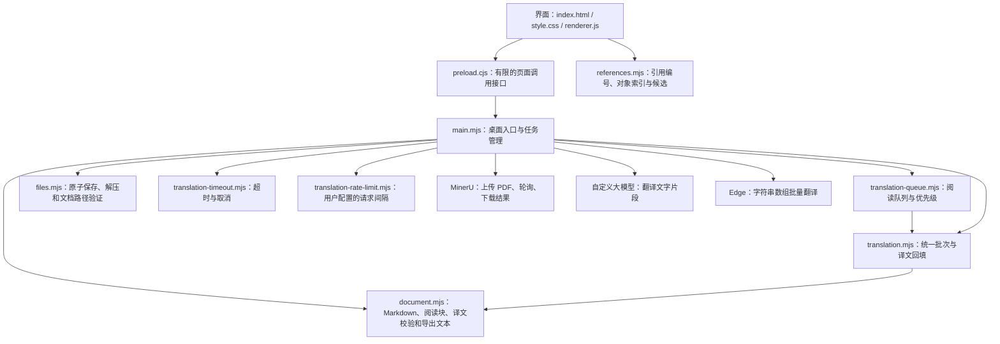

# 早日发Paper 项目逻辑与清理记录

检查日期：2026-10-13。适用范围：当前 `paperbridge` 源码，单人使用、单窗口、一次一个文档任务。

当前界面接入 MinerU 解析与云端 API、本地大模型、Edge 翻译。在“翻译配置”栏目内选择方式，云端和本地配置分别保留。本地模式连接用户自行启动的 OpenAI 兼容服务，不管理模型权重或 Python 进程。Edge 使用固定 HTTPS 接口和字符串数组批量请求，无需密钥，不发送其他服务的密钥。此前专用千问进程启动器、百度翻译和旧多配置管理的未接入 JavaScript 模块已经清理。仓库不含模型权重、Python 环境、旧 `qwen-server` 服务、个人文库或已保存密钥。

## 文件之间的关系

| 要修改的内容 | 对应文件 |
| --- | --- |
| 页面结构、按钮和配置输入项 | `index.html` |
| 配色、边框、字号显示与分栏布局 | `style.css` |
| 点击、拖动、滚动、设置自动保存与界面刷新 | `renderer.js` |
| 图表公式编号识别、索引与跳转候选 | `references.mjs` |
| 文本分块、格式保留与导出内容 | `document.mjs` |
| 批量大小、请求估算、缓存跳过、译文回填 | `translation.mjs` |
| 阅读队列排序、去重、暂停与完成 | `translation-queue.mjs` |
| HTTP 地址、解析服务、密钥存储、任务和桌面窗口 | `main.mjs` |
| 超时强停和中止操作 | `translation-timeout.mjs` |
| 翻译与连接测试的访问频率 | `translation-rate-limit.mjs` |
| 文件写入、ZIP 读取限制和删除路径检查 | `files.mjs` |
| 界面可以调用哪些主程序接口 | `preload.cjs` |

## 三条主要流程

### 导入与解析

导入 PDF/Markdown → 检查格式与大小 → 计算文件摘要，复用同一文件的文库副本 → 保存原件。

Markdown 直接构建阅读块，并复制同目录下允许的图片。PDF 在已配置 MinerU 时自动解析：申请上传地址 → 上传 → 轮询批次 → 下载并保存 ZIP → 检查解压路径和大小 → 读取 Markdown 与图片 → 构建阅读块。

解析暂停后保持暂停，点击“继续解析”复用原批次和上传记录；失败时可明确选择重新提交。已有本机 ZIP 优先用于恢复。

### 翻译与阅读

`document.mjs` 将长普通段落按句子或词边界拆成约 360 字符的小块，短尾部重新平衡，不把末尾单词独立成块。公式、代码和行内格式按结构保留。旧长块可以迁移分块；同一原段落的旧短尾部合并并重映射缓存，不重复翻译已完成片段。人工编辑过的块保持原样。

打开文档 → 收集可视的未完成块 → 补充后续完整的待译块，尽量装满一次请求 → 阅读队列去重并优先安排新看到的内容 → 统一批次规则按云端可配置的片段数与字符预算生成请求（默认 20 个片段、4000 字符） → 校验返回 ID、完整性与内容 → 回填译文 → 原子保存 → 通知界面更新。阅读队列每完成一次请求便重新检查优先级，不再每 40 块强制分组。

全文翻译、边读边译与单块重译共用 `translation.mjs`。单块重译使用临时副本，只有整个块成功才替换旧译文。全部完成时队列退出并释放任务；文档仍有未读的待译块时才继续等待滚动。

HTML 表格使用 parse5 读取单元格文本及源码范围，将可译文字纳入同一批次；公式和代码不发送给服务。译文按源码位置回填并转义，HTML 结构和 rowspan/colspan 不变。旧文档打开时准备原先保留的 HTML 表格，参考文献仍保持保留。长表格不进入普通段落拆分逻辑。界面清理 HTML 后用 KaTeX auto-render 渲染单元格公式，再次清理输出；禁用受信任的 LaTeX 命令，不执行文档中的脚本。

云端翻译入口、重译和连接测试共用限频：相邻请求开始时间使用同一个动态限频器，云端间隔可配置为 0–120 秒，完全按当前设置计算，0 表示串行连续发送而不额外限频。失败请求也占用间隔，取消等待不会发送请求。非零间隔在启动后同样先等待；长响应耗时已经超过间隔时不再额外等待。本地模式不加间隔，默认批次 3000 字符、最多 80 个片段，字数预算可配置。Edge 模式同样不加间隔，单次最多 200 个文本片段、22500 字符；返回结果按顺序映射回片段 ID，并检查数量及非空文本。云端与 Edge 翻译限时 120 秒，本地翻译限时 180 秒，连接测试限时 20 秒。超时或主动暂停都会中止等待；已落盘译文保留。HTTP 429 等失败不自动重发。

界面保留原文节点，只更新译文和状态，并合并短时间内的多次通知，以保持阅读位置和文字选区。

图片从原文节点移到同一个阅读块的共享图片区，译文渲染时移除图片，不复制媒体资源；图片链接、图标题的翻译及缓存仍保留。白天/黑夜主题通过 CSS 颜色变量切换，选择写入页面本地存储；有限的 `setTheme` 页面接口验证主题后同步更新系统标题栏与窗口背景，不中断文档任务。

引用导航以原文的真实图片、表格和 KaTeX 公式建立索引，结合图表说明与公式标签解析编号，普通引用段落不会被当作目标。原文结构变化时重建索引，只有译文更新时保留索引和原文节点。原文/译文的普通引用文字变为可点击链接，保留强调、代码与外部链接。点击后定位当前模式可见的对象并短暂高亮；返回栈保存阅读块 ID、原文/译文区域、相对屏幕偏移及模式。蓝色大号返回按钮悬浮在目标上方，跳转为按钮预留空隙；滚动、正文刷新及 ResizeObserver 更新按钮位置，并限制在阅读视口内。目标译文重新渲染后按目标 ID 找到新的节点，全部返回或切换文档后隐藏按钮。目标在译文中缺失时暂时切到原文，返回时恢复原模式。重复或缺失编号由用户选择，`localStorage` 的 `references:<文档ID>` 保存选择，Shift 点击可更改；切换文档清空返回栈，删除文档清理对应记录。不增加网络请求或改变译文缓存。

### 设置与本地数据

文内搜索在 `renderer.js` 从阅读节点及缓存译文收集可见文字，不读取其他文档或设置字段、不调用搜索服务。跨强调/链接的文字仍连续索引，段落和单元格分隔，KaTeX 的重复 MathML 文本排除。查询转义后按字面文字匹配并忽略大小写，每次出现单独生成上下文条目，无固定结果数量截断。原文节点和译文文本缓存复用；150 毫秒合并输入，正文/译文变化时刷新结果。结果跳转复用引用导航和返回栈，用 DOM Range 定位具体文字、CSS Highlight 高亮，不插入正文标签；长表格/代码的溢出容器横向滚动，隐藏语言临时显示。搜索面板支持 Ctrl＋F、Esc、沉浸阅读和窄窗口自动收起；切换/删除文档清空查询与高亮。

段落复制通过限定的 `copyText` 页面接口调用 Electron clipboard，验证字符串和 5 MB 字符上限，并保留格式字符。原有页面来源校验及浏览器权限拒绝策略保持有效，不开放读取系统剪贴板的接口。测试用替代写入函数验证参数和边界，不改写用户剪贴板。

打开顶部设置时先暂停运行任务并等待保存结束。两个栏目默认折叠，保存的内容已经载入，点击标题展开后显示带缩进和底色的输入区域。输入修改后约 550 毫秒自动保存，关闭窗口和测试连接前先完成待保存内容。保存失败会阻止连接测试使用旧参数。升级首次默认选择 Edge，同时保留旧服务的地址、模型和密钥；之后用户手动选定的方式保存并在重启后恢复。

MinerU、云端翻译和本地服务密钥在 Windows 上通过 Electron safeStorage 分别加密；界面默认隐藏。本地密钥可留空，不会回退使用云端密钥。本地端点只允许本机地址。清空密钥输入并保存会移除对应密钥。设置加载只接受当前配置字段。

数据目录可从设置中打开，侧栏右键文档可打开其独立的 `documents/<文档ID>/` 文件夹。原始 PDF 与原始 Markdown 保留；同一次文档保存还自动生成 `parsed.md`、`translated.md`，后者包含已完成译文、人工编辑和带标记的未完成原文。文件中的本地图片路径指向 `content/`，按 Markdown 图片、图片引用定义及 HTML 图片属性分别重映射，不修改源语法树或 ZIP 导出路径。先原子保存 `document.json`，再原子保存生成文件，写入失败保留可恢复的任务记录。旧文档启动时补齐缺失的生成文件，无需翻译请求。

右键菜单通过 Electron 原生 Menu 展示打开文件夹、重命名、永久删除；关闭菜单不执行操作。重命名更新文档标题并保存，文档 ID、文件夹和缓存不变。删除默认取消，明确确认后永久删除文桥文库副本，不进入回收站；原始导入文件和独立导出文件保留。重命名与删除共用操作锁，不与翻译、解析、测试连接交叉执行。文件夹读取及永久删除使用 `documentDirectory` 检查严格 UUID、解析后的文库根目录及其直接子目录，拒绝符号链接/目录联接；任务记录 ID 必须与文件夹对应。Windows 对普通 AppData 目录的系统重定向不视为链接，操作使用经过检查的逻辑子目录，打开文件夹/PDF 时再解析实际路径供外部程序使用。删除后清理页面阅读位置、引用选择和当前文档状态。主动全文重译仍先保存 `previous-translation.json`。

## 本次清理与修复

- 删除未接入运行程序的 `local-translation.mjs`、旧本地模块测试、百度重试限流代码及对应测试。
- 合并全文、阅读队列、单块重译的批量处理；估算和实际发送使用相同的批次边界。
- 删除没有使用的等待控制器、重复串行请求链、仅转发调用的函数和重复 Markdown 解析。
- 删除旧配置面板的失效测试与未使用的样式，更新测试以匹配当前界面。
- 修复全部翻译完成后任务不释放、PDF 暂停后自行重启、请求不响应取消时暂停被拖住的问题。
- 修复设置关闭前未完成保存、保存失败仍测试旧配置、清空密钥没有生效的问题。
- 修复目录折叠按钮被固定到窗口外的位置，并统一分栏默认宽度来源。
- 支持旧文档再次分块形成的多级块 ID，校验仍拒绝无效 ID。
- 旧本地/百度文档转为当前服务时，校验原文与目标语言，避免把不同目标语言的缓存混用。

## 测试结果与范围

| 命令 | 结果 | 覆盖内容 |
| --- | --- | --- |
| `npm.cmd run check` | 通过 | 所有运行模块的语法 |
| `npm.cmd test` | 48 项通过 | 分块、格式、短尾部平衡、旧缓存合并、响应校验、缓存、保存、永久删除路径和目录链接保护、Windows 系统目录重定向、队列、批次、每分钟限频、预译、本地配置边界、服务切换、Edge 语言代码与返回校验、HTML 表格及长表格结构、公式保护、转义和旧表格迁移、超时和取消、中英文引用编号、相邻标题索引、子图及重复/缺失编号、文件夹 Markdown 图片路径 |
| `npm.cmd run test:ui` | 通过 | 顶部工具栏及醒目设置入口、设置默认折叠和字段缩进、失败保存、立即关闭、密钥显示、拖动分栏、目录图标与展开状态、字号、沉浸模式、无确认重译、左右与上下切换、HTML/Markdown 表格公式渲染、代码与合并单元格保留、安全清理、四种模式图片单份及链接/图标题保留、主题切换与重载恢复、正文节点及阅读稳定性、引用导航与悬浮返回、侧栏右键打开文件夹、重命名刷新、取消删除及确认删除后的界面清理 |
| `npm.cmd run test:app` | 通过 | 真实主程序、页面接口、密钥加密、仅可见 2 块时预译 85 块合为 1 请求、云端共享限频、缓存复用、429 不重试、暂停、PDF 恢复、图片 ZIP 导出；文档文件夹 Markdown 生成、译文及人工编辑同步、旧缓存启动补齐不调用 API、原生菜单项目、重命名校验与保存、取消删除、永久删除只清理文库副本和运行任务时禁止删除/重命名；真实本机 HTTP 服务测试连接、本地批量翻译、可选密钥隔离和不限频；Edge 批量、缓存、错误保留、取消、密钥隔离及设置恢复 |

整机测试运行在独立临时数据目录，使用模拟服务响应，不读取真实文库、密钥或调用付费 API。界面测试截图位于上级 `docs/paperbridge-local-settings-test.png`。另实测 Edge 接口：两段普通文本以及 200 段、22000 字符的公开示例均返回 HTTP 200，返回段数一致。

表格测试截图位于上级 `docs/paperbridge-table-math-test.png`。整机测试另覆盖旧 HTML 表格载入迁移、Edge 单元格批量翻译、公式不变、缓存跳过和 Markdown 导出。真实 Edge 使用 5 个公开示例片段验证 HTTP 200、回填完整且公式源码保持不变；这不等于术语翻译质量校验。

白天主题截图位于上级 `docs/paperbridge-day-theme-test.png`。整机测试也验证运行翻译任务时主题切换不会暂停任务，非法主题参数被拒绝，窗口背景随主题更新。

引用导航截图位于上级 `docs/paperbridge-reference-navigation-test.png`。界面测试覆盖四种阅读模式、沉浸阅读、带强调的引用、已有文内链接、LaTeX `\tag`/`\tag*` 及 HTML 表内编号、连跳返回、译文更新后返回位置偏移小于 1 像素、重复/缺失编号选择、保存与重载、更改选择和跨文档隔离。另检查返回按钮位于图表公式上方、字号与按钮高度、滚动及可见窗口缩放后的视口边界、目标译文重建后的定位。无法从 MinerU 输出中恢复缺失的图片或推断未保留的编号，此类位置需人工选择。

未验证真实服务商的账户权限、余额、网络情况、翻译语义质量或真实 MinerU 版面识别质量。

文内搜索截图位于上级 `docs/paperbridge-document-search-test.png`。界面测试另外覆盖同段重复词和跨强调匹配、大小写、正则特殊字符按字面处理、emoji、结果片段不注入 HTML、隐藏的原文/译文切换及返回、译文更新、180 条匹配全部列出、长表格深处及末列定位、沉浸阅读、窄窗口、空查询/无结果、名称搜索独立、切换及删除文档清理。复制测试验证浏览器写入被拒绝时仍通过页面接口复制；整机测试校验桌面剪贴板写入参数、格式保留及非法/超大输入拒绝。

清理前源码备份：上级 `docs/paperbridge-source-before-cleanup-2026-10-13.zip`。
